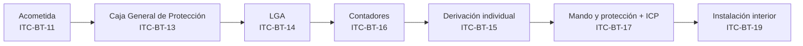

# Lección: ITC-BT-14 — Instalaciones de enlace. Línea General de Alimentación

> **Aviso de nomenclatura.** ITC-BT-14 es la **Línea General de Alimentación (LGA)**, no la derivación individual. Se confunden porque van pegadas en la cadena.

| ITC | Elemento |
| --- | --- |
| ITC-BT-13 | Caja General de Protección (CGP) |
| **ITC-BT-14** | **Línea General de Alimentación (LGA)** |
| ITC-BT-15 | Derivaciones individuales |
| ITC-BT-16 | Contadores: ubicación y sistemas de instalación |

`[FUENTE: md/ITC-BT-13.md, md/ITC-BT-14.md, md/ITC-BT-15.md, md/ITC-BT-16.md §título]`

---

## En una frase

La LGA es el **tramo común** de la instalación de enlace: lleva la energía desde la Caja General de Protección hasta la centralización de contadores, y la comparten todos los abonados del edificio.

`[FUENTE: md/ITC-BT-14.md §1]` — «Es aquella que enlaza la Caja General de Protección con la centralización de contadores. De una misma línea general de alimentación pueden hacerse derivaciones para distintas centralizaciones de contadores.»

---

## Desarrollo

### Definición

Tres límites que fijan todo lo demás:

- **Aguas arriba:** Caja General de Protección (ITC-BT-13). Ahí termina la propiedad de la compañía.
- **Aguas abajo:** centralización de contadores (ITC-BT-16).
- **Es compartida:** por eso su sección se dimensiona con la previsión de cargas de **todo** el edificio, no con la de un abonado.

### Constitución

Siempre conductores aislados, y puede ir en:

- Tubos empotrados.
- Tubos enterrados.
- Tubos en montaje superficial.
- Canales protectoras cuya tapa solo se pueda abrir con la ayuda de un útil.
- Canalizaciones eléctricas prefabricadas (UNE-EN-60.439-2).
- Conductos cerrados de obra de fábrica, proyectados y construidos al efecto.

Los tubos y canales, así como su instalación, cumplen la **ITC-BT-21** salvo lo indicado en la propia ITC-BT-14. **En cualquier caso la canalización incluye el conductor de protección.**

`[FUENTE: md/ITC-BT-14.md §1]`

### Cables

| Prescripción | Valor |
| --- | --- |
| Composición | Tres de fase y uno de neutro |
| Material | Cobre o aluminio, unipolares y aislados |
| Tensión asignada | 0,6/1 kV |
| Comportamiento al fuego | No propagadores del incendio, con emisión de humos y opacidad reducida |
| Norma de conformidad | UNE 21.123 partes 4 ó 5 |
| Sección mínima | 10 mm² en cobre / 16 mm² en aluminio |
| Continuidad | Sección uniforme en todo el recorrido y **sin empalmes** |

La única excepción a la ausencia de empalmes son las **derivaciones realizadas en el interior de cajas para alimentación de centralizaciones de contadores**.

Los elementos de conducción de cables con características equivalentes a los clasificados como «no propagadores de la llama» según las normas UNE-EN 50085-1 y UNE-EN 50086-1 cumplen la prescripción.

Con **conductores de aluminio**, las conexiones se realizan con las técnicas apropiadas que eviten el deterioro del conductor por aparición de potenciales peligrosos originados por los efectos de los pares galvánicos.

`[FUENTE: md/ITC-BT-14.md §3]`

### Criterios de cálculo

La sección se determina teniendo en cuenta **simultáneamente** dos condiciones:

1. La **máxima caída de tensión permitida**.
2. La **intensidad máxima admisible**.

#### Caída de tensión máxima permitida

| Tipo de LGA | Caída de tensión máxima |
| --- | --- |
| Destinada a contadores **totalmente centralizados** | **0,5 %** |
| Destinada a **centralizaciones parciales** de contadores | **1 %** |

`[FUENTE: md/ITC-BT-14.md §3]`

#### Intensidad máxima admisible

La fija la **UNE 20.460-5-523**, con los factores de corrección correspondientes a cada tipo de montaje, de acuerdo con la previsión de potencias establecida en la **ITC-BT-10**.

`[FUENTE: md/ITC-BT-14.md §3]`
`[VERIFICAR: UNE 20.460-5-523]` — tabla de intensidades admisibles y factores de corrección: **no está en el corpus del proyecto**.

#### Fórmula de caída de tensión

La ITC-BT-14 fija el **límite**, no la fórmula. La geometría del cálculo es la general de líneas:

```
Trifásica:  ΔU = √3 · L · I · cos φ / (γ · S)
Monofásica: ΔU = 2 · L · I · cos φ / (γ · S)
```

Y el porcentaje, que es contra lo que se compara:

```
ΔU% = (ΔU / U) · 100
```

**Unidades**

| Símbolo | Magnitud | Unidad |
| --- | --- | --- |
| ΔU | Caída de tensión | V |
| L | Longitud de la línea | m |
| I | Intensidad de cálculo | A |
| cos φ | Factor de potencia | adimensional |
| S | Sección del conductor | mm² |
| γ | Conductividad del material | m/(Ω·mm²) |
| U | Tensión (de línea en trifásica) | V |

**Cuándo se usa:** para **verificar** una sección ya elegida contra el límite reglamentario. Para dimensionar, se tantea con la tabla 1 y se comprueba.

### Conductor neutro

Sección de **aproximadamente el 50 %** de la del conductor de fase, no siendo inferior a los valores de la tabla 1. Se tienen en cuenta el máximo desequilibrio previsible, las corrientes armónicas y su comportamiento, en función de las protecciones ante sobrecargas y cortocircuitos.

`[FUENTE: md/ITC-BT-14.md §3]`

### Tabla 1 — Secciones y diámetro exterior de tubos

| Secciones (mm²) |  | Diámetro exterior de los tubos (mm) |
| --- | --- | --- |
| FASE | NEUTRO |  |
| 10 (Cu) | 10 | 75 |
| 16 (Cu) | 10 | 75 |
| 16 (Al) | 16 | 75 |
| 25 | 16 | 110 |
| 35 | 16 | 110 |
| 50 | 25 | 125 |
| 70 | 35 | 140 |
| 95 | 50 | 140 |
| 120 | 70 | 160 |
| 150 | 70 | 160 |
| 185 | 95 | 180 |
| 240 | 120 | 200 |

`[FUENTE: tablas/_v2/ITC-BT-14_t01.csv]`

### Instalación

- El trazado será **lo más corto y rectilíneo posible**, discurriendo por **zonas de uso común**.
- En el interior de tubos, el diámetro en función de la sección del cable a instalar es el de la tabla 1.
- Las dimensiones de otros tipos de canalizaciones deben permitir la **ampliación de la sección de los conductores en un 100 %**.
- Cables aislados y conductores de protección en el interior de tubos enterrados: se cumple lo especificado en la **ITC-BT-07**, salvo lo indicado en la ITC-BT-14.
- Las uniones de los tubos rígidos serán **roscadas o embutidas**, de modo que no puedan separarse los extremos.
- Cuando discurra **verticalmente**, lo hará por el interior de una canaladura o conducto de obra de fábrica empotrado o adosado al hueco de la escalera, por lugares de uso común.
- **No podrá ir adosada o empotrada** a la escalera o zona de uso común cuando estos recintos sean protegidos conforme a lo establecido en la NBE-CPI-96.
- Se evitarán las curvas, los cambios de dirección y la influencia térmica de otras canalizaciones del edificio.
- El conducto será **registrable y precintable en cada planta**, con **cortafuegos cada tres plantas como mínimo**, paredes de **resistencia al fuego RF 120** según NBE-CPI-96 y **tapas de registro RF 30** como mínimo.
- **Dimensiones mínimas del conducto: 30 × 30 cm**, destinado única y exclusivamente a alojar la LGA y el conductor de protección.

`[FUENTE: md/ITC-BT-14.md §2]`

### Dónde encaja la LGA en la cadena



*Lectura: la LGA es el tramo 3. Mirar sus dos vecinos dice de qué es responsable y de qué no.*

> **Estado de validación: no validado con `mmdc`** (no disponible en esta máquina).

---

## Ejemplo resuelto

**Enunciado.** Edificio de viviendas con **centralización total de contadores**. LGA trifásica a 400 V, longitud 25 m, cobre, intensidad de cálculo 60 A, cos φ = 0,9. Verificar si una sección de fase de **25 mm²** cumple.

**Fórmula.**

```
ΔU = √3 · L · I · cos φ / (γ · S)          ΔU% = (ΔU / U) · 100
```

**Datos (con unidades).**

- U = 400 V (tensión de línea, trifásica)
- L = 25 m
- I = 60 A
- cos φ = 0,9 (adimensional)
- S = 25 mm²
- γ_Cu = 56 m/(Ω·mm²) — **constante de material a 20 °C, no es un valor del REBT**. El corpus no la incluye; se fija explícitamente aquí para que cada número tenga origen trazable. `[VERIFICAR: valor de material]`

**Sustitución.**

```
ΔU = 1,732 · 25 · 60 · 0,9 / (56 · 25)
   = 2338,3 / 1400
   = 1,67 V
```

**Resultado (con unidades).**

```
ΔU% = (1,67 / 400) · 100 = 0,42 %
```

Límite aplicable: 0,5 % (centralización total). Como 0,42 % < 0,5 % → **CUMPLE**.

`[FUENTE: md/ITC-BT-14.md §3]` para el límite del 0,5 %.

*Margen pequeño: con 16 mm² la caída se dispara por encima del límite.*

---

## Ejercicios

Sin soluciones.

**1. (Básico — conceptual)**
Un edificio tiene LGA que alimenta **dos centralizaciones parciales** de contadores. ¿Qué caída de tensión máxima admite, y por qué difiere del caso de centralización total?

**2. (Medio — tabla)**
La LGA de un edificio lleva fase de **35 mm² en cobre**. Indicar:
(a) sección del neutro;
(b) diámetro exterior del tubo;
(c) ¿es admisible empalmar la LGA a mitad de recorrido vertical? Justificar con el articulado.

**3. (Aplicado — cálculo)**
LGA trifásica a 400 V, centralización **total** de contadores. Longitud 30 m, cobre, intensidad de cálculo **80 A**, cos φ = 0,9. Verificar si **35 mm²** cumple la caída máxima reglamentaria. Trabajar con γ_Cu = 56 m/(Ω·mm²) e indicar en qué se apoya para fijar el límite.

---

## Resumen

- La LGA une **CGP → centralización de contadores**: es el tramo común del edificio, dimensionado con la previsión de cargas total (ITC-BT-10).
- Se calcula contra **dos** criterios a la vez: caída máxima (**0,5 %** centralización total / **1 %** parcial) e intensidad admisible (UNE 20.460-5-523).
- Mínimo **10 mm² Cu / 16 mm² Al**, sección uniforme y sin empalmes, siempre con conductor de protección; neutro ≈ 50 % de la fase con el suelo de la tabla 1.

---

## Marcadores pendientes

| Marcador | Qué falta |
| --- | --- |
| `[VERIFICAR: UNE 20.460-5-523]` | Tabla de intensidades admisibles y factores de corrección aplicables a la LGA. No está en el corpus. |
| `[VERIFICAR: valor de material]` | γ_Cu = 56 m/(Ω·mm²) a 20 °C: constante física, no norma. Confirmar si el enunciado no la facilita. |

---

## Siguiente tema

- ITC-BT-15 — Derivaciones individuales (cierra la cadena de enlace), o
- Bloque 9 del temario — Protecciones.

---

*Material de estudio elaborado a partir del corpus normativo del proyecto. No sustituye al técnico competente ni al proyecto visado.*
